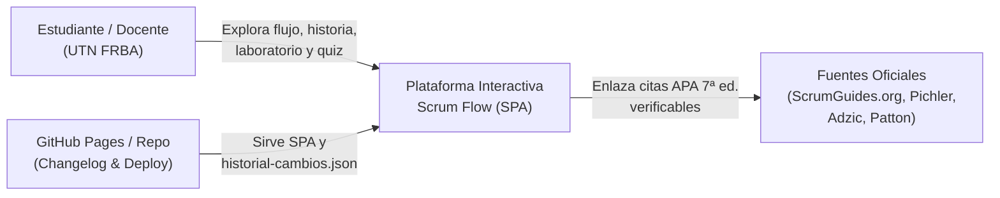
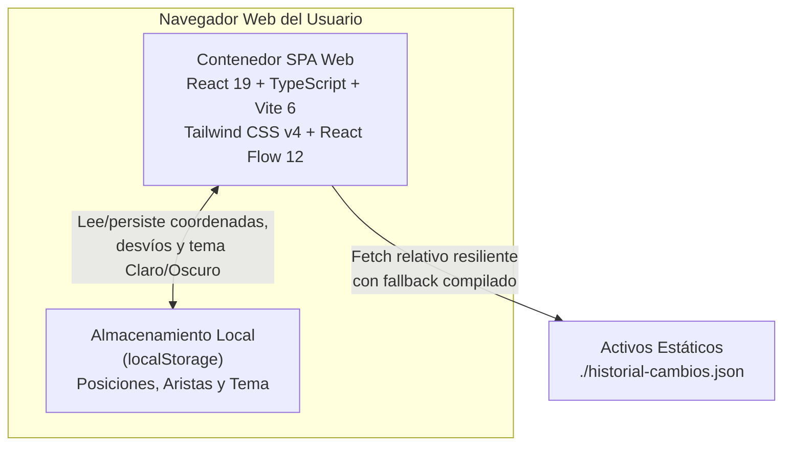

# Arquitectura C4 — Nivel 1 (Contexto) y Nivel 2 (Contenedores)

Este documento define el diseño arquitectónico de la evolución de **Flujo Metodológico Scrum**, garantizando el aislamiento de dominio y la trazabilidad hacia fuentes oficiales.

---

## 1. Nivel 1 — Diagrama de Contexto del Sistema

### Actores y Límites
- **Usuario (Estudiante / Docente):** Navega por el mapa 3D (*Swimlanes*), sigue los 4 recorridos históricos (*General, Scrum Master, Product Owner, Developers*), consulta el caso práctico E-commerce y utiliza el **Laboratorio Scrum**.
- **Sistemas Externos:**
  - *Fuentes Oficiales*: Enlaces salientes seguros (`noopener noreferrer`) con citación APA 7ª edición.
  - *GitHub Pages / Estático*: Provee la aplicación compilada y `public/historial-cambios.json` relativo a `BASE_URL`.

---

## 2. Nivel 2 — Diagrama de Contenedores

### Decisiones de Contenedor
1. **Cero Backend Requerido:** Toda la lógica pedagógica, validación de esquemas en frontera, cálculos de *timebox* y evaluación de quiz operan del lado del cliente con latencia cero.
2. **Soberanía y Persistencia Local:** Posiciones personalizadas, estados de aristas y preferencia de tema (`dark` por defecto / `light`) persisten en `localStorage` con degradación segura en memoria.
3. **Despliegue Portátil (`base: './'`):** Toda carga estática respeta `import.meta.env.BASE_URL` para funcionar tanto en dominio raíz como en subrutas (`/scrum/`).
