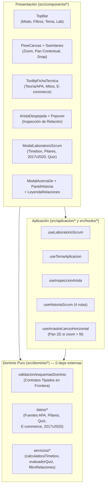

# Arquitectura C4 — Nivel 3 (Componentes) y Nivel 4 (Código y Reglas)

## 1. Nivel 3 — Diagrama de Componentes y Fronteras

### Invariantes Estructurales (`reglasArquitectura.cjs`)
1. **`src/dominio/` 100% Aislado:** Cero importaciones a `node_modules`, React, `@xyflow/react`, `aplicacion` o `presentacion`.
2. **Validación en Frontera sin Peso Extra:** `esquemasDominio.ts` provee un validador tipado en tiempo de ejecución en TypeScript puro (sin añadir librerías externas pesadas al bundle) e infiere los contratos usados por el dominio y los tests.
3. **Regla de Hierro (< 200 líneas):** Cada módulo de dominio, hook y subcomponente del Laboratorio y Tooltip se divide en archivos atómicos bajo 200 líneas.

---

## 2. Nivel 4 — Estructura Modular de Archivos Planificada

| Capa | Ruta | Responsabilidad (< 200 líneas c/u) |
| :--- | :--- | :--- |
| **Dominio** | `src/dominio/tiposDominio.ts` | Tipos puros de fuentes APA, antipatrones, E-commerce, quiz y tiempo. |
| **Dominio** | `src/dominio/validacion/esquemasDominio.ts` | Validadores tipados en frontera de nodos, fuentes APA, quiz y preferencias. |
| **Dominio** | `src/dominio/datos/fuentesOficiales.ts` | Catálogo verificado de citas APA 7ª ed. (Scrum Guide 2020, Pichler, Adzic, Patton). |
| **Dominio** | `src/dominio/datos/fundamentosScrum.ts` | 3 Pilares empíricos, 5 Valores de Scrum y Comparativa 2017 vs. 2020. |
| **Dominio** | `src/dominio/datos/ejemplosEcommerce.ts` | Caso práctico *MercadoÁgil* de punta a punta por cada nodo del flujo. |
| **Dominio** | `src/dominio/datos/contenidoEnriquecidoNodos.ts` | Antipatrones, glosario de siglas y citas APA por `nodeId`. |
| **Dominio** | `src/dominio/datos/metadatosAristas.ts` | Explicación pedagógica, impacto de omisión y cita APA por `edgeId`. |
| **Dominio** | `src/dominio/datos/bancoQuizScrum.ts` | Preguntas situacionales con nodo vinculado y fuente APA. |
| **Dominio** | `src/dominio/servicios/calculadoraTimebox.ts` | Cálculo proporcional oficial de duración máxima de eventos según semanas. |
| **Dominio** | `src/dominio/servicios/evaluadorQuiz.ts` | Evaluación pura de respuestas, puntaje y diagnóstico por categoría. |
| **Dominio** | `src/dominio/servicios/filtroRelaciones.ts` | Cálculo de opacidad/foco de aristas según filtros o nodo seleccionado. |
| **Datos Grafo** | `src/data/datosHistoriaDevelopers.ts` | 4ª perspectiva narrativa guiada para *Developers*. |
| **Datos Grafo** | `src/data/datosRoles.ts`, `datosEventos.ts`, `datosArtefactos.ts`, `datosAristas.ts` | Corrección teórica 2020, `origenMarco`, `y = 257` uniforme y aristas faltantes. |
| **Aplicación** | `src/hooks/useTemaAplicacion.ts`, `useInspeccionArista.ts`, `useLaboratorioScrum.ts` | Gestión de tema Claro/Oscuro, inspección de aristas y estado del Laboratorio. |
| **Presentación** | `src/components/laboratorio/*.tsx` | `ModalLaboratorioScrum`, `CalculadoraTimebox`, `VistaPilaresValores`, `TablaComparativaGuias`, `QuizScrumInteractivo`. |
| **Presentación** | `src/components/nodes/TooltipFichaTecnica.tsx` + pestañas | Pestañas moduladas (`Teoría`, `Mitos`, `E-commerce`) y citas APA clicables. |
| **Presentación** | `src/components/edges/PopoverDetalleArista.tsx` | Panel flotante para inspeccionar relaciones al hacer clic en aristas. |
