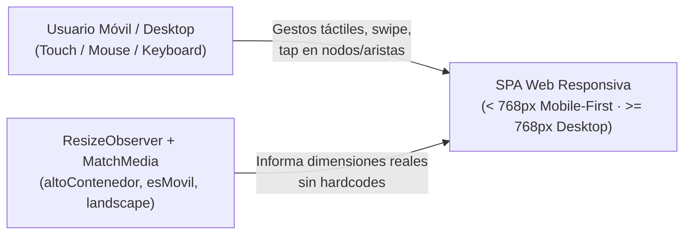
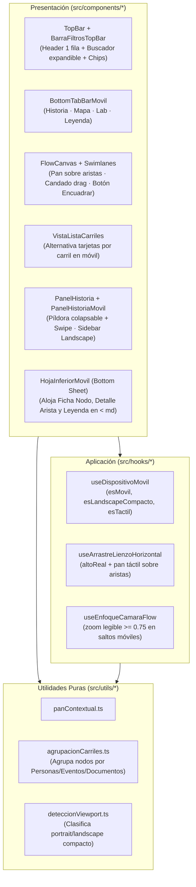

# Arquitectura C4 — Evolución Mobile-First y Ergonomía Táctil

Este documento extiende la arquitectura del sistema (`01-contexto-y-contenedores.md` y `02-componentes-y-codigo.md`) para cumplir los requerimientos `RF-11` a `RF-16` de `especificaciones/04-experiencia-movil.md`.

---

## 1. Niveles 1 y 2 — Contexto y Contenedores (Adaptación Responsiva)

El sistema mantiene el mismo **Contenedor SPA Web** (React 19 + TypeScript + Vite 6 + Tailwind CSS v4 + React Flow 12) sin backend adicional. La adaptación móvil se resuelve en cliente mediante detección reactiva de viewport y tamaño real de lienzo:

---

## 2. Nivel 3 — Diagrama de Componentes y Fronteras

### Invariantes Arquitectónicos
1. **Aislamiento de Dominio (`src/dominio/*`):** Permanece 100% libre de imports externos, React o `@xyflow/react`.
2. **Cero Módulos Huérfanos:** Se retira `src/components/DetailDrawer.tsx` (sin uso actual) al introducir `HojaInferiorMovil.tsx` y su contenido reutilizable (`ContenidoDetalleArista.tsx` / `ContenidoLeyenda.tsx` + `TooltipFichaTecnica.tsx`).
3. **Regla de Hierro (< 200 líneas):** Todos los componentes nuevos y refactorizados se mantienen por debajo de 200 líneas mediante separación estricta de vistas móviles y hooks.

---

## 3. Nivel 4 — Plan Modular de Archivos (< 200 líneas c/u)

| Capa | Archivo | Responsabilidad |
| :--- | :--- | :--- |
| **Utilidades** | `src/utils/deteccionViewport.ts` | Funciones puras `clasificarViewport(ancho, alto, esPunteroGrueso)`. |
| **Utilidades** | `src/utils/agrupacionCarriles.ts` | Agrupa nodos filtrados en 3 carriles (*Personas*, *Eventos*, *Documentos*). |
| **Utilidades** | `src/utils/panContextual.ts` | Mantiene lógica pura de paneo 2D con altura real medida del lienzo. |
| **Aplicación** | `src/hooks/useDispositivoMovil.ts` | Hook reactivo con `resize` / `matchMedia` (`esMovil`, `esLandscapeCompacto`, `esTactil`). |
| **Aplicación** | `src/hooks/useArrastreLienzoHorizontal.ts` | Mide altura de `<main>` vía `ResizeObserver` y permite pan táctil sobre aristas. |
| **Aplicación** | `src/hooks/useEnfoqueCamaraFlow.ts` | Garantiza zoom legible al saltar desde Quiz o Vista Lista. |
| **Presentación** | `src/components/movil/HojaInferiorMovil.tsx` | Bottom Sheet accesible (`role="dialog"`, backdrop, `Escape`, botón cierre `>= 44px`). |
| **Presentación** | `src/components/movil/BottomTabBarMovil.tsx` | Barra inferior fija en `< md` (`Historia`, `Mapa`, `Lab`, `Leyenda`) con targets `>= 44px`. |
| **Presentación** | `src/components/movil/PanelHistoriaMovil.tsx` | Hoja inferior colapsable a píldora en portrait, swipe horizontal y lateral en landscape. |
| **Presentación** | `src/components/movil/VistaListaCarriles.tsx` | Vista lista/tarjetas por carril con apertura en Bottom Sheet y salto al mapa. |
| **Presentación** | `src/components/TopBar.tsx` + `BarraFiltrosTopBar.tsx` | Header 1 fila en `< md`, buscador expandible, `aria-label` completos y chips de categoría visibles. |
| **Presentación** | `src/components/FlowCanvas.tsx` + `Swimlanes.tsx` | Candado de arrastre de nodos en touch, botón `Encuadrar` (`>= 44px`) y chips de carril. |
| **Presentación** | `src/components/edges/PopoverDetalleArista.tsx` + `LeyendaRelaciones.tsx` | Extraen contenido puro para reutilizarse tanto en popover desktop como en `HojaInferiorMovil`. |
| **Presentación** | `src/components/laboratorio/CalculadoraTimebox.tsx` + Modales | Botones `whitespace-nowrap`, targets `>= 44px` y `max-h-[90dvh]` para landscape. |
