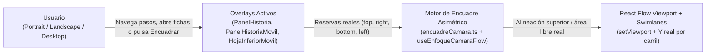
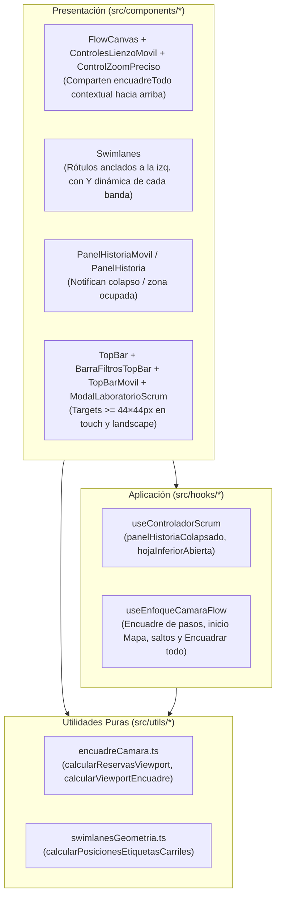

# Arquitectura C4 — Encuadre Asimétrico, Carriles Dinámicos y Pulido Táctil

Este documento extiende la arquitectura del sistema ([`03-arquitectura-movil.md`](file:///E:/@Documentos/OneDrive/IT/Proyectos/2026%20-%20Scrum/scrum/docs/arquitectura/03-arquitectura-movil.md)) para satisfacer los requerimientos `RF-17` a `RF-20` de [`05-encuadre-superior-y-ergonomia.md`](file:///E:/@Documentos/OneDrive/IT/Proyectos/2026%20-%20Scrum/scrum/especificaciones/05-encuadre-superior-y-ergonomia.md).

---

## 1. Niveles 1 y 2 — Contexto y Contenedores

La solución se ejecuta íntegramente en la **SPA Web React + Vite + React Flow** existente, sustituyendo el centrado ciego del lienzo por un motor geométrico que conoce las áreas ocupadas por paneles narrativos, hojas inferiores y barras de control en cada tamaño de pantalla:

---

## 2. Nivel 3 — Componentes y Fronteras de Dependencia

### Invariantes Arquitectónicos
1. **Dominio Puro y Sin Ciclos:** [`src/dominio/*`](file:///E:/@Documentos/OneDrive/IT/Proyectos/2026%20-%20Scrum/scrum/src/dominio) se mantiene intacto sin imports de React ni `@xyflow/react`; la geometría matemática reside en `src/utils/` sin importar UI.
2. **Única Fuente de Encuadre:** [`ControlZoomPreciso`](file:///E:/@Documentos/OneDrive/IT/Proyectos/2026%20-%20Scrum/scrum/src/components/ControlZoomPreciso.tsx) y [`ControlesLienzoMovil`](file:///E:/@Documentos/OneDrive/IT/Proyectos/2026%20-%20Scrum/scrum/src/components/movil/ControlesLienzoMovil.tsx) invocan el mismo comando de encuadre provisto por [`FlowCanvas`](file:///E:/@Documentos/OneDrive/IT/Proyectos/2026%20-%20Scrum/scrum/src/components/FlowCanvas.tsx).
3. **Regla de Hierro (`< 200` líneas):** Cada archivo nuevo o modificado se mantiene debajo de 200 líneas.

---

## 3. Nivel 4 — Plan Modular de Archivos y Contratos

| Capa | Archivo | Responsabilidad |
| :--- | :--- | :--- |
| **Utilidades** | `src/utils/encuadreCamara.ts` *(nuevo)* | Funciones puras `calcularReservasViewport(...)` y `calcularViewportEncuadre(caja, lienzo, opciones)`: alinea verticalmente hacia arriba cuando los 3 carriles caben o cuando hay reserva inferior, y centra en la franja libre disponible. |
| **Utilidades** | `src/utils/swimlanesGeometria.ts` | Añade `calcularPosicionesEtiquetasCarriles(zoom, yViewport, altoLienzo)` para posicionar *Personas*, *Eventos* y *Documentos* dentro de sus bandas reales. |
| **Aplicación** | `src/hooks/useEnfoqueCamaraFlow.ts` | Usa `getNodesBounds`, dimensiones medidas del contenedor y `setViewport` para encuadrar pasos de Historia, inicio de Mapa, saltos externos y retorna `encuadrarMapaCompleto`. |
| **Aplicación** | `src/hooks/useControladorScrum.ts` | Gestiona `panelHistoriaColapsado` y expone `hojaInferiorAbierta` para coordinar reservas de cámara. |
| **Presentación** | `src/components/Swimlanes.tsx` | Consume `calcularPosicionesEtiquetasCarriles` con `viewport.zoom` y `viewport.y` para eliminar posiciones fijas por porcentaje. |
| **Presentación** | `src/components/FlowCanvas.tsx`, `ControlesLienzoMovil.tsx`, `ControlZoomPreciso.tsx` | Conectan `encuadrarMapaCompleto` en arranque y botones *Encuadrar todo el mapa* (escritorio y móvil). |
| **Presentación** | `src/components/movil/PanelHistoriaMovil.tsx`, `src/App.tsx` | Pasan estado de colapso e indicación de hoja inferior abierta al encuadre. |
| **Presentación** | `src/components/movil/TopBarMovil.tsx`, `ModalLaboratorioScrum.tsx`, `TopBar.tsx`, `BarraFiltrosTopBar.tsx` | Aseguran `min-w-[44px] min-h-[44px]` en `Docs`, pestañas del Laboratorio y cabecera en entorno táctil / landscape `844×390`. |
