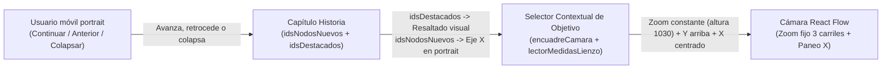
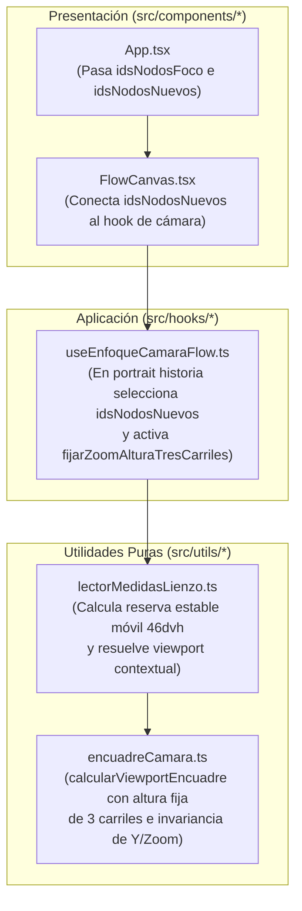

# Arquitectura C4 — Paneo Horizontal por Pasos con Zoom Constante de 3 Carriles

Este documento extiende [`04-arquitectura-encuadre-superior.md`](file:///E:/@Documentos/OneDrive/IT/Proyectos/2026%20-%20Scrum/scrum/docs/arquitectura/04-arquitectura-encuadre-superior.md) para implementar los requerimientos `RF-21` a `RF-23` definidos en [`06-paneo-carriles-historia-movil.md`](file:///E:/@Documentos/OneDrive/IT/Proyectos/2026%20-%20Scrum/scrum/especificaciones/06-paneo-carriles-historia-movil.md).

---

## 1. Niveles 1 y 2 — Contexto y Contenedores

La lógica reside íntegramente en la **SPA Web React + Vite + React Flow**, separando el **resaltado visual narrativo** ([`idsDestacados`](file:///E:/@Documentos/OneDrive/IT/Proyectos/2026%20-%20Scrum/scrum/src/data/datosHistoria.ts#L14-L15)) del **objetivo geométrico de paneo horizontal en móvil vertical** ([`idsNodosNuevos`](file:///E:/@Documentos/OneDrive/IT/Proyectos/2026%20-%20Scrum/scrum/src/data/datosHistoria.ts#L12-L13)):

---

## 2. Nivel 3 — Componentes y Flujo de Dependencias

### Invariantes Arquitectónicos
1. **Separación Destacado Visual vs. Objetivo de Cámara**: [`useHistoriaScrum`](file:///E:/@Documentos/OneDrive/IT/Proyectos/2026%20-%20Scrum/scrum/src/hooks/useHistoriaScrum.ts) y [`calcularElementosVisiblesHistoria`](file:///E:/@Documentos/OneDrive/IT/Proyectos/2026%20-%20Scrum/scrum/src/hooks/useHistoriaScrum.ts#L18-L48) no cambian: los nodos previos en `idsDestacados` siguen resaltados a opacidad `1.0`, pero en móvil vertical no estiran el zoom hacia atrás.
2. **Invariancia Matemática entre Capítulos**: Mientras `panelHistoriaColapsado` conserve su estado en móvil vertical, `reservas.abajo` utiliza el tope estable de [`PanelHistoriaMovil`](file:///E:/@Documentos/OneDrive/IT/Proyectos/2026%20-%20Scrum/scrum/src/components/movil/PanelHistoriaMovil.tsx#L122) (`max-h-[46dvh]`) para que diferencias menores de líneas entre narrativas no alteren `zoom` ni `y` entre capítulos.
3. **Aislamiento de Modos**: `landscape` compacto, escritorio (`>= 768px`), **Mapa Libre** y saltos externos (`nodoEnfocadoExterno`) mantienen sin cambios el encuadre por caja de nodos completos.
4. **Regla de Hierro (`< 200` líneas) y 0 ciclos**: Ningún módulo nuevo o editado superará las 200 líneas ni importará desde UI hacia dominio/utilidades.

---

## 3. Nivel 4 — Plan Modular de Archivos y Contratos

| Capa | Archivo | Cambio concreto |
| :--- | :--- | :--- |
| **Utilidades** | [`src/utils/encuadreCamara.ts`](file:///E:/@Documentos/OneDrive/IT/Proyectos/2026%20-%20Scrum/scrum/src/utils/encuadreCamara.ts) | Añadir `fijarZoomAlturaTresCarriles?: boolean` a `OpcionesEncuadreAsimetrico`. Cuando está activo: calcula `zoom` exclusivamente con `ALTURA_TOTAL_FLUJO_CARRILES` dentro de `altoUtil`, alinea `y` arriba desde `LIMITE_SUPERIOR_CARRILES_FLOW` verificando fondo de 3 carriles completos (invariante por paso) y centra `x` en el punto medio de `caja`. |
| **Utilidades** | [`src/utils/lectorMedidasLienzo.ts`](file:///E:/@Documentos/OneDrive/IT/Proyectos/2026%20-%20Scrum/scrum/src/utils/lectorMedidasLienzo.ts) | Agregar `fijarZoomAlturaTresCarriles` a `ContextoResolucionViewport` y usar reserva inferior determinista del tope `46dvh` en historia portrait expandida (y `72px` al colapsar para recalcular zoom completo según `RF-23`). Incorporar helper puro `resolverIdsObjetivoHistoria(...)` con fallback defensivo. |
| **Aplicación** | [`src/hooks/useEnfoqueCamaraFlow.ts`](file:///E:/@Documentos/OneDrive/IT/Proyectos/2026%20-%20Scrum/scrum/src/hooks/useEnfoqueCamaraFlow.ts) | Aceptar `idsNodosNuevos?: string[]`. Cuando `esMovil && !esLandscapeCompacto && modoActivo === 'historia'`, enfocar `idsNodosNuevos` (con fallback a `idsNodosFoco`) activando `fijarZoomAlturaTresCarriles: true` tanto en carga inicial como al avanzar/retroceder, colapsar/expandir panel o redimensionar. |
| **Presentación** | [`src/App.tsx`](file:///E:/@Documentos/OneDrive/IT/Proyectos/2026%20-%20Scrum/scrum/src/App.tsx) y [`src/components/FlowCanvas.tsx`](file:///E:/@Documentos/OneDrive/IT/Proyectos/2026%20-%20Scrum/scrum/src/components/FlowCanvas.tsx) | Pasar `idsNodosNuevos={c.historia.capituloActual.idsNodosNuevos}` desde `App` hasta `useEnfoqueCamaraFlow`. |
| **Pruebas TDD** | [`tests/encuadreCamara.test.ts`](file:///E:/@Documentos/OneDrive/IT/Proyectos/2026%20-%20Scrum/scrum/tests/encuadreCamara.test.ts) | Pruebas unitarias en ciclo Rojo/Verde para zoom/Y invariantes entre etapas, múltiples nodos nuevos sin alejar zoom, recálculo al colapsar panel y fallback cuando `idsNodosNuevos` está vacío. |
