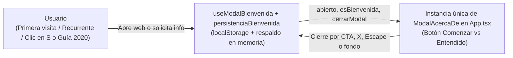
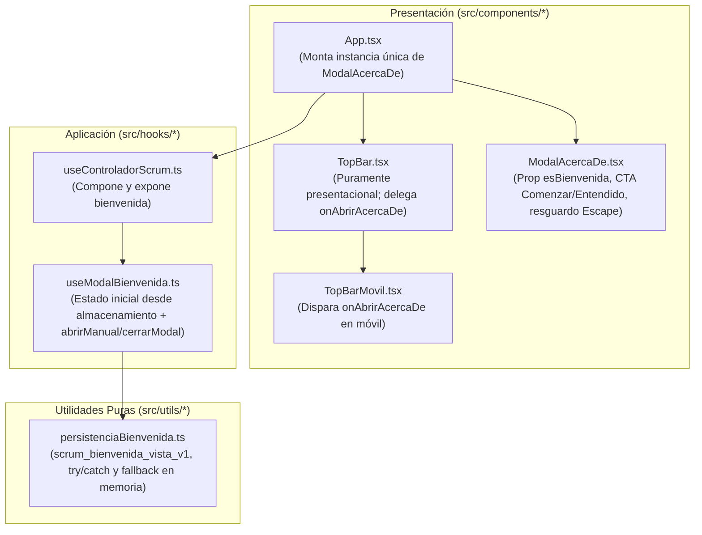

# Arquitectura C4 — Modal «Acerca de» como Pantalla de Bienvenida

Este documento extiende la arquitectura del sistema ([`05-arquitectura-paneo-carriles-movil.md`](file:///E:/@Documentos/OneDrive/IT/Proyectos/2026%20-%20Scrum/scrum/docs/arquitectura/05-arquitectura-paneo-carriles-movil.md)) para satisfacer los requerimientos `RF-24` a `RF-26` definidos en [`07-modal-bienvenida-acerca-de.md`](file:///E:/@Documentos/OneDrive/IT/Proyectos/2026%20-%20Scrum/scrum/especificaciones/07-modal-bienvenida-acerca-de.md).

---

## 1. Niveles 1 y 2 — Contexto y Contenedores

La solución se ejecuta íntegramente dentro de la **SPA Web React + Vite**, centralizando el ciclo de vida del modal informativo en una única instancia controlada por estado de aplicación y persistencia local tolerante a fallos:

---

## 2. Nivel 3 — Componentes y Fronteras de Dependencia

### Invariantes Arquitectónicos
1. **Instancia Única de Diálogo**: Al trasladar `<ModalAcercaDe />` desde [`TopBar.tsx`](file:///E:/@Documentos/OneDrive/IT/Proyectos/2026%20-%20Scrum/scrum/src/components/TopBar.tsx) hacia [`App.tsx`](file:///E:/@Documentos/OneDrive/IT/Proyectos/2026%20-%20Scrum/scrum/src/App.tsx), se elimina la duplicación interna en los retornos móvil y escritorio de `TopBar` y se mantiene la cabecera puramente presentacional.
2. **Aislamiento de Persistencia y Dominio Puro**: [`src/dominio/*`](file:///E:/@Documentos/OneDrive/IT/Proyectos/2026%20-%20Scrum/scrum/src/dominio) no sufre modificaciones ni importa utilidades de navegador; toda lectura/escritura sobre `localStorage` queda aislada en `src/utils/persistenciaBienvenida.ts` con respaldo en memoria.
3. **Protección de Escape Anidado**: Mientras [`ModalHistorialCambios`](file:///E:/@Documentos/OneDrive/IT/Proyectos/2026%20-%20Scrum/scrum/src/components/ModalHistorialCambios.tsx) esté abierto sobre `ModalAcercaDe`, presionar `Escape` cierra primero el historial sin cerrar prematuramente la pantalla de bienvenida.
4. **Regla de Hierro (`< 200` líneas) y 0 Ciclos**: Todos los archivos nuevos y modificados permanecen debajo de las 200 líneas sin dependencias circulares.

---

## 3. Nivel 4 — Plan Modular de Archivos y Contratos

| Capa | Archivo | Responsabilidad y contrato |
| :--- | :--- | :--- |
| **Utilidades** | `src/utils/persistenciaBienvenida.ts` *(nuevo, ~55 líneas)* | Exporta `CLAVE_BIENVENIDA_VISTA = 'scrum_bienvenida_vista_v1'`, `debeMostrarBienvenidaInicial(storage?)`, `marcarBienvenidaVista(storage?)` y `reiniciarEstadoBienvenidaMemoria()`, con captura segura `try/catch` y estado fallback en memoria. |
| **Aplicación** | `src/hooks/useModalBienvenida.ts` *(nuevo, ~40 líneas)* | Inicializa perezosamente `{ abierto, esBienvenida }` a partir de `debeMostrarBienvenidaInicial()` y expone `abrirManual()` (`esBienvenida: false`) y `cerrarModal()` (persiste marca vista y cierra). |
| **Aplicación** | [`src/hooks/useControladorScrum.ts`](file:///E:/@Documentos/OneDrive/IT/Proyectos/2026%20-%20Scrum/scrum/src/hooks/useControladorScrum.ts) | Integra `const bienvenida = useModalBienvenida()` y la expone en el estado orquestado de la app. |
| **Presentación** | [`src/components/ModalAcercaDe.tsx`](file:///E:/@Documentos/OneDrive/IT/Proyectos/2026%20-%20Scrum/scrum/src/components/ModalAcercaDe.tsx) | Añade `esBienvenida?: boolean`; alterna etiqueta del CTA (`"Comenzar"` vs `"Entendido"`), resetea historial al cerrar y deshabilita su listener `Escape` mientras `mostrarHistorial` esté activo. |
| **Presentación** | [`src/components/TopBar.tsx`](file:///E:/@Documentos/OneDrive/IT/Proyectos/2026%20-%20Scrum/scrum/src/components/TopBar.tsx) | Elimina estado local y montajes duplicados de `ModalAcercaDe`; recibe `onAbrirAcercaDe: () => void` y lo delega al logo `S`, badge `Guía 2020` y `TopBarMovil`. |
| **Presentación** | [`src/App.tsx`](file:///E:/@Documentos/OneDrive/IT/Proyectos/2026%20-%20Scrum/scrum/src/App.tsx) | Conecta `onAbrirAcercaDe={c.bienvenida.abrirManual}` en `<TopBar />` y monta la instancia única `<ModalAcercaDe abierto={c.bienvenida.abierto} esBienvenida={c.bienvenida.esBienvenida} alCerrar={c.bienvenida.cerrarModal} />`. |
| **Pruebas TDD** | `tests/persistenciaBienvenida.test.ts` *(nuevo)* y [`tests/ModalAcercaDe.test.ts`](file:///E:/@Documentos/OneDrive/IT/Proyectos/2026%20-%20Scrum/scrum/tests/ModalAcercaDe.test.ts) | Verifican primera visita, persistencia tras cierre, fallback seguro ante storage inaccesible/roto y renderizado contextual de `"Comenzar"` vs `"Entendido"`. |
