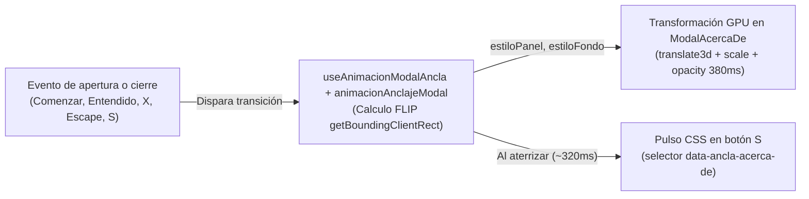
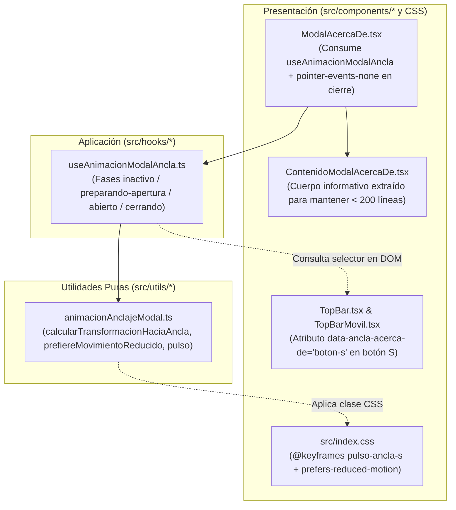

# Arquitectura C4 — Animación Bidireccional del Modal «Acerca de» hacia el Botón «S»

Este documento extiende [`06-arquitectura-modal-bienvenida.md`](file:///E:/@Documentos/OneDrive/IT/Proyectos/2026%20-%20Scrum/scrum/docs/arquitectura/06-arquitectura-modal-bienvenida.md) para implementar los requerimientos `RF-27` a `RF-29` definidos en [`08-animacion-modal-ancla-s.md`](file:///E:/@Documentos/OneDrive/IT/Proyectos/2026%20-%20Scrum/scrum/especificaciones/08-animacion-modal-ancla-s.md).

---

## 1. Niveles 1 y 2 — Contexto y Contenedores

La arquitectura desacopla el cálculo vectorial puro del anclaje (`FLIP` mediante `getBoundingClientRect()`) de la máquina de estados del ciclo de vida del modal, logrando animaciones compuestas por GPU (`transform` y `opacity`) sin afectar el layout ni acoplar `ModalAcercaDe` con referencias directas de DOM entre componentes hermanos:

---

## 2. Nivel 3 — Componentes y Fronteras de Dependencia

### Invariantes Arquitectónicos
1. **Animación Exclusiva en Capas Compuestas (GPU)**: Solo se animan `transform` y `opacity`; quedan prohibidas propiedades de pintado o geometría (`width`, `height`, `top`, `left`).
2. **Desacoplamiento entre Ancla y Modal**: [`ModalAcercaDe`](file:///E:/@Documentos/OneDrive/IT/Proyectos/2026%20-%20Scrum/scrum/src/components/ModalAcercaDe.tsx) no requiere recibir `refs` desde [`TopBar`](file:///E:/@Documentos/OneDrive/IT/Proyectos/2026%20-%20Scrum/scrum/src/components/TopBar.tsx) ni [`TopBarMovil`](file:///E:/@Documentos/OneDrive/IT/Proyectos/2026%20-%20Scrum/scrum/src/components/movil/TopBarMovil.tsx); consulta únicamente `[data-ancla-acerca-de="boton-s"]` con respaldo seguro si no existe.
3. **Persistencia Inmediata e Interrumpibilidad**: Al solicitar el cierre, `alCerrar()` persiste el estado de bienvenida inmediatamente mientras la animación corre de forma no bloqueante (`pointer-events-none`). Si `abierto` vuelve a `true` antes de finalizar los `380 ms`, los timers pendientes se cancelan limpiamente.
4. **Regla de Hierro (`< 200` líneas) y 0 Ciclos**: La extracción de `ContenidoModalAcercaDe.tsx` garantiza holgura por debajo de 200 líneas en todos los componentes y cero ciclos entre capas.

---

## 3. Nivel 4 — Plan Modular de Archivos y Contratos

| Capa | Archivo | Responsabilidad y contrato |
| :--- | :--- | :--- |
| **Utilidades** | `src/utils/animacionAnclajeModal.ts` *(nuevo, ~60 líneas)* | Exporta `calcularTransformacionHaciaAncla(rectModal, rectAncla)` (acotando escala a `[0.05..0.25]` y degradando con fallback sin ancla), `prefiereMovimientoReducido(matcher?)` y `dispararPulsoRecepcionAncla(elemento)`. |
| **Aplicación** | `src/hooks/useAnimacionModalAncla.ts` *(nuevo, ~100 líneas)* | Gestiona las fases `'inactivo' \| 'preparando-apertura' \| 'abierto' \| 'cerrando'`, timers limpiables, apertura inversa desde `"S"` en doble `requestAnimationFrame` (salteada cuando `esBienvenida === true`), interrumpibilidad y pulso de recepción al aterrizar. |
| **Presentación** | `src/components/ContenidoModalAcercaDe.tsx` *(nuevo, ~95 líneas)* | Encapsula el contenido informativo scrolleable (Guía 2020, citas APA 7ª ed., autoría y versión) reduciendo el tamaño de `ModalAcercaDe.tsx`. |
| **Presentación** | [`src/components/ModalAcercaDe.tsx`](file:///E:/@Documentos/OneDrive/IT/Proyectos/2026%20-%20Scrum/scrum/src/components/ModalAcercaDe.tsx) *(~110 líneas)* | Orquesta el portal accesible usando `useAnimacionModalAncla` y `ContenidoModalAcercaDe`, aplicando `refPanel`, `estiloPanel`, `estiloFondo` y `pointer-events-none` en cierre. |
| **Presentación** | [`src/components/TopBar.tsx`](file:///E:/@Documentos/OneDrive/IT/Proyectos/2026%20-%20Scrum/scrum/src/components/TopBar.tsx) y [`TopBarMovil.tsx`](file:///E:/@Documentos/OneDrive/IT/Proyectos/2026%20-%20Scrum/scrum/src/components/movil/TopBarMovil.tsx) | Agregan `data-ancla-acerca-de="boton-s"` en el botón `"S"` de escritorio y móvil. |
| **Estilos** | [`src/index.css`](file:///E:/@Documentos/OneDrive/IT/Proyectos/2026%20-%20Scrum/scrum/src/index.css) | Define `@keyframes pulso-ancla-s` y `.pulso-recepcion-ancla-s`, desactivándolos automáticamente bajo `@media (prefers-reduced-motion: reduce)`. |
| **Pruebas TDD** | `tests/animacionAnclajeModal.test.ts` *(nuevo)* | Verifica cálculo vectorial `(dx, dy)`, escala acotada `[0.05..0.25]`, respaldo seguro sin ancla y detección de `prefers-reduced-motion`. |
