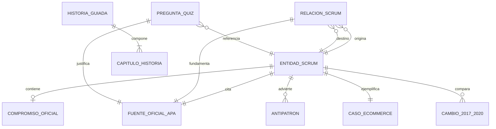

# Modelo de Dominio y Lenguaje Ubicuo (`Ubiquitous Language`)

Este documento define las entidades, objetos de valor, invariantes y fuentes oficiales que rigen la evolución teórica e interactiva de **Flujo Metodológico Scrum**, alineado estrictamente con la **Guía Oficial de Scrum 2020** y sus prácticas complementarias de *Product Discovery*.

---

## 1. Lenguaje Ubicuo (Glosario Oficial)

| Término en Dominio | Significado Canónico (Guía 2020 / Práctica) | Término Deprecado o a Aclarar |
| :--- | :--- | :--- |
| **Scrum Team** | Unidad cohesiva sin subequipos ni jerarquías: 1 Product Owner, 1 Scrum Master y Developers. | *Development Team* (eliminado en 2020). |
| **Accountabilities** | Responsabilidades dentro del Scrum Team (*Product Owner*, *Scrum Master*, *Developers*). | *Roles* (usado en 2017 y como alias visual). |
| **Eventos de Scrum** | Contenedor (*Sprint*) y 4 eventos internos formales de inspección y adaptación. | *Ceremonias* (alias popular no oficial). |
| **Product Goal** | Compromiso oficial del *Product Backlog*: estado futuro del producto a largo plazo. | — |
| **Sprint Goal** | Compromiso oficial del *Sprint Backlog*: único objetivo coherente del Sprint. | — |
| **Definition of Done (DoD)** | Compromiso oficial del *Increment*: estándar formal de calidad para que sea utilizable. | — |
| **Increment (Utilizable)** | Peldaño concreto, aditivo y verificable hacia el *Product Goal*. | *PSPI* (*Potentially Shippable*, 2017). |
| **PBI** | *Product Backlog Item*: elemento unitario del Product Backlog listo para refinar o planificar. | — |
| **Product Discovery** | Prácticas complementarias previas al Backlog (*Vision Board*, *Impact Mapping*, *Story Map*). | No son artefactos oficiales Scrum. |

---

## 2. Entidades y Objetos de Valor

### Objetos de Valor Estructurados (Validables con Esquema Tipado)
- **`FuenteOficialAPA`**: `{ id, citaApa, seccion, urlOficial, etiquetaEnlace }`.
- **`CompromisoOficial`**: `{ nombre, descripcion }` (presente únicamente en los 3 artefactos oficiales Scrum).
- **`Antipatron`**: `{ mito, realidad, consecuencia }`.
- **`CasoPracticoEcommerce`**: `{ tituloPaso, artefactoEjemplo, elementosClave[], conexionSiguiente }`.
- **`Comparativa2017vs2020`**: `{ aspecto, guia2017, guia2020, razonCambio }`.
- **`EscenarioQuiz`**: `{ id, categoria, escenario, opciones[], indiceCorrecto, explicacion, nodoRelacionadoId, fuenteId }`.

---

## 3. Invariantes de Dominio (Reglas Inquebrantables)

1. **Distinción Oficial vs. Discovery**: Solo `artifact-product-backlog`, `artifact-sprint-backlog` y `artifact-increment` poseen `origenMarco: 'scrum-oficial'` y exactamente 1 `compromisoOficial` cada uno. Las herramientas previas (`vision-board`, `impact-mapping`, `user-story-mapping`) se clasifican como `origenMarco: 'discovery-complementario'` y nunca muestran el sello de compromiso oficial Scrum.
2. **Trazabilidad Bibliográfica Obligatoria**: Toda entidad (`EntidadScrum`), relación (`RelacionScrum`), capítulo de historia, pilar/valor y pregunta de quiz DEBE referenciar al menos una `FuenteOficialAPA` válida y verificable.
3. **Proporcionalidad de Timeboxes (Guía 2020)**: Para un Sprint de $S \in \{1, 2, 3, 4\}$ semanas (siendo 4 semanas equivalente a 1 mes):
   - *Sprint Planning*: $\le 2 \times S$ horas (máx. 8 h).
   - *Sprint Review*: $\le 1 \times S$ horas (máx. 4 h).
   - *Sprint Retrospective*: $\le 0.75 \times S$ horas (máx. 3 h).
   - *Daily Scrum*: siempre **15 minutos** constantes, independiente de $S$.
4. **Aislamiento de Dominio**: Los módulos de datos, cálculos de timebox, evaluación de quiz y esquemas de validación pertenecen al dominio puro, sin importar React, Tailwind ni `@xyflow/react`.

---

## 4. Fuentes Oficiales Canónicas (Formato APA 7ª ed.)

- Schwaber, K., & Sutherland, J. (2020). *The Scrum Guide: The Definitive Guide to Scrum: The Rules of the Game* (Ed. noviembre 2020). ScrumGuides.org. https://scrumguides.org/scrum-guide.html (Traducciones oficiales en español: https://scrumguides.org/download.html)
- Pichler, R. (2011, 10 de mayo). *The Product Vision Board*. Pichler Consulting. https://www.romanpichler.com/blog/the-product-vision-board/
- Adzic, G. (2012). *Impact Mapping: Making a Big Impact with Software Products and Projects*. Provoking Thoughts. https://www.impactmapping.org/
- Patton, J., & Economy, P. (2014). *User Story Mapping: Discover the Whole Story, Build the Right Product*. O'Reilly Media. https://www.oreilly.com/library/view/user-story-mapping/9781491904893/
